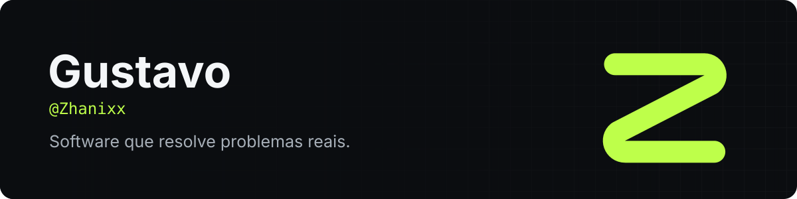

  

Olá! Sou o Gustavo. Crio programas para Windows, Android e web, quase sempre a partir de um problema concreto: um PC lento, um certificado preenchido à mão, uma conta repetida todo dia na produção.

## Projeto principal

### [ZHX Flow](https://github.com/Zhanixx/zhxflow)

Otimizador para Windows que diagnostica o PC, aplica só os ajustes que você aprovar e prova o resultado com medições de antes e depois.

  

  
  
  

## Outros projetos

| Projeto | O que faz | Feito com |
|---|---|---|
| [**CalibraDoc**](https://github.com/Zhanixx/Certified-calibration) · [abrir](https://zhanixx.github.io/Certified-calibration/Index.html) | Emite certificados de calibração em 5 etapas, com assinatura digital e PDF pronto para impressão | HTML, CSS, JavaScript |
| [**Calculadora de Proporções**](https://github.com/Zhanixx/teste-proporcao) · [abrir](https://zhanixx.github.io/teste-proporcao/) | Calcula e verifica a tolerância de resina, reparos e massa de cola, em português e chinês | HTML, CSS, JavaScript |

## Tecnologias

  
  
  
  
  
  

